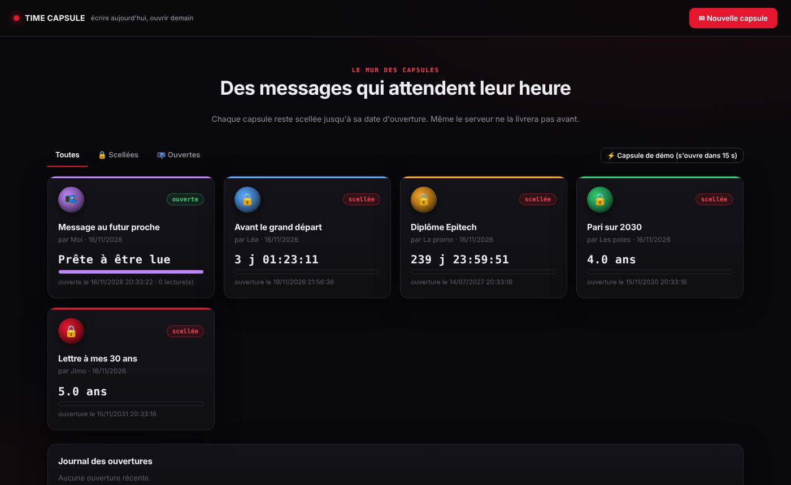
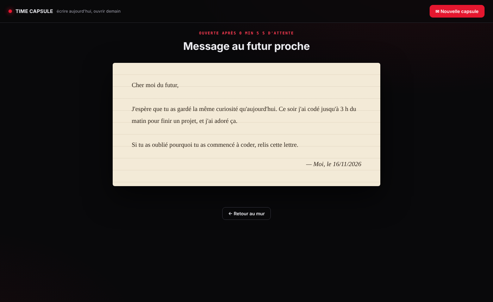

# ⏳ Time Capsule

> Écrivez une lettre, joignez des photos et programmez leur ouverture à une date future : une minute, un an ou dix ans plus tard.

| Le mur des capsules | Une capsule ouverte |
|---|---|
|  |  |

## Fonctionnalités
- **Écriture** d'une lettre, ajout de **photos** (6 maximum, redimensionnées dans le navigateur), signature et couleur du sceau.
- **Date d'ouverture** au choix, avec des raccourcis (1 minute, 1 semaine, 1 mois, 1 an, 5 ans).
- **Scellé côté serveur** : l'API refuse de livrer le contenu avant l'heure. Le compte à rebours affiché est synchronisé sur l'horloge du serveur, pas sur celle du visiteur.
- **Chiffrement de bout en bout** optionnel : avec une phrase secrète, le contenu est chiffré dans le navigateur (WebCrypto, **PBKDF2-SHA256 avec 200 000 itérations et AES-GCM 256 bits**). Le serveur ne stocke que du chiffré et ne peut jamais le lire. Un indice peut être laissé.
- **Planificateur** en arrière-plan : il détecte les capsules arrivées à échéance, les inscrit au journal des ouvertures et envoie un **e-mail** si SMTP est configuré.
- **Mur public** avec comptes à rebours en direct, barre de progression et filtres, **lien de partage** pour chaque capsule, animation d'ouverture d'enveloppe.

## Lancer
```bash
pip install -r requirements.txt
python app.py         # → http://127.0.0.1:5007
python -m pytest -q
```
Le bouton **« Capsule de démo »** crée une capsule qui s'ouvre au bout de 15 secondes.

E-mails (facultatif) : `SMTP_HOST`, `SMTP_PORT`, `SMTP_USER`, `SMTP_PASS`, `SMTP_FROM`, `PUBLIC_URL`.

## Pistes
- Capsules collectives (une promo écrit chacun sa lettre, ouverture commune)
- Messages audio et vidéo
- Stockage objet (S3) pour les capsules volumineuses

## Licence
MIT © Jimo0x
